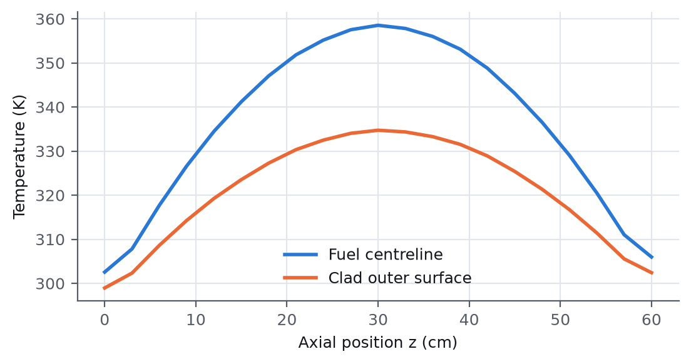
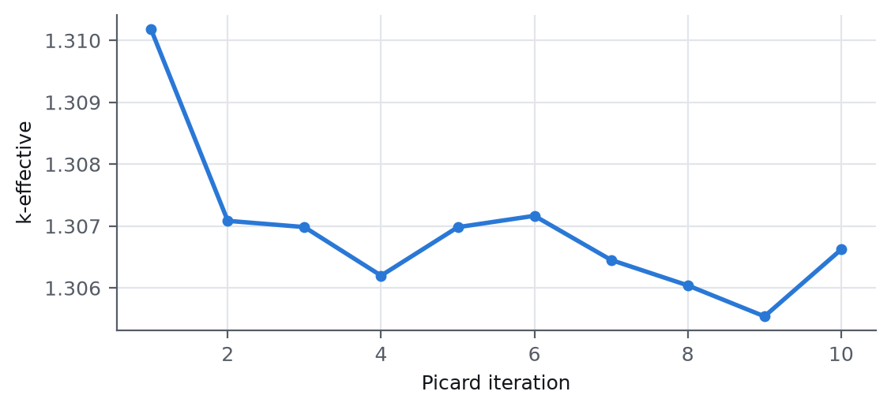

# TRIGA Mark I — Coupled Multiphysics Model with Cardinal

An independent multiphysics model of a TRIGA Mark I research reactor built on
the Cardinal ecosystem: **OpenMC** (continuous-energy Monte Carlo neutronics),
**MOOSE** (solid heat conduction) and **NekRS** (spectral-element CFD).
It is one half of a cross-code benchmark; a separate GeN-Foam model of the
same reactor is compared against it.

**Status: interim.** Standalone neutronics and two-way OpenMC–MOOSE coupling
are complete. NekRS is not yet part of the coupled chain (see *Limitations*).

## Headline results

Standalone OpenMC, ENDF/B-VIII.0, 293 K, 20 M histories:

| Quantity | Model | Value |
|---|---|---|
| k-infinity | 2-D unit cell, reflective | 1.384207 ± 0.000214 |
| k-effective | 3-D bare heterogeneous core, vacuum | 1.102059 ± 0.000260 |
| Pin power peak/average | bare core, 120 pins | 2.254 |

Two-way OpenMC–MOOSE coupling (average pin, ENDF/B-VII.1, 10 Picard iterations):

| Quantity | Value |
|---|---|
| Coupled k-effective | 1.30662 ± 0.00055 |
| Average / maximum fuel temperature | 330.4 / 359.0 K |
| Average / maximum clad temperature | 322.3 / 336.1 K |

Full tables and discussion: [`results/PCM_RESULTS.md`](results/PCM_RESULTS.md).
Report: [`docs/TRIGA_Reference_Report.pdf`](docs/TRIGA_Reference_Report.pdf).

<p align="center">
  
  
</p>

## Repository layout

```
cardinal/openmc/    OpenMC geometry, materials, tallies, run and post-processing
cardinal/moose/     MOOSE mesh input
cardinal/coupling/  OpenMC–MOOSE coupled model (Picard iteration)
cardinal/nekrs/     NekRS fluid case (.par/.udf/.re2)
spec/               Problem specification: geometry, materials, operating, thermal
results/            Curated CSV/JSON results and figures (with SHA256SUMS)
docs/               Runbook, porting notes, LaTeX report and figures
scripts/            Environment setup, run and report-generation scripts
```

## Reproducing

See [`docs/RUNBOOK.md`](docs/RUNBOOK.md) for the environment (Cardinal, MOOSE,
NekRS, OpenMC, nuclear data) and step-by-step run instructions.

## Limitations

- The coupled result uses an imposed coolant heat-transfer surrogate; NekRS is
  not yet in the coupling chain.
- The standalone NekRS diagnostic ran on a mesh in which only 59% of the clad
  surface kept the heated-wall boundary ID, so its fields are not used
  physically. The mesh generator has been corrected; a rerun is pending.
- No rod-transient result yet.
- Core results depend on two open specification questions (core diameter
  reading; homogenized vs heterogeneous fuel and the hydrogen S(α,β) kernel),
  recorded in `PCM_STATUS.md`.

## Development notes

AI coding assistants were used for some code scaffolding, debugging and
documentation drafting. The physics modelling, simulation setup, validation
and interpretation of results are the author's own.

## Author

Kavya Wadhwa, Pandit Deendayal Energy University.
