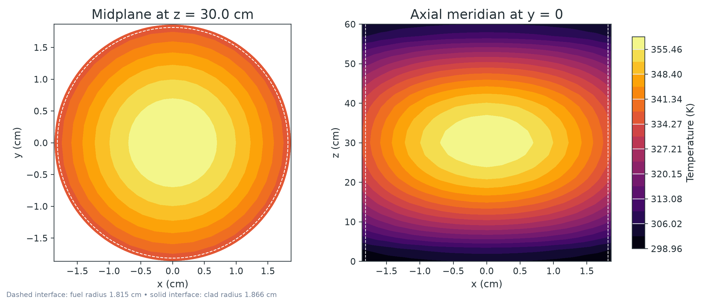
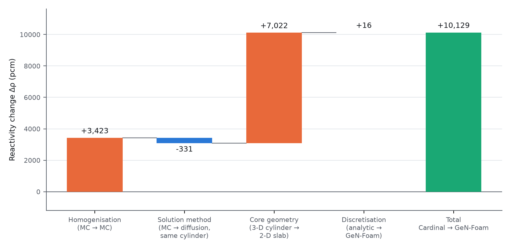
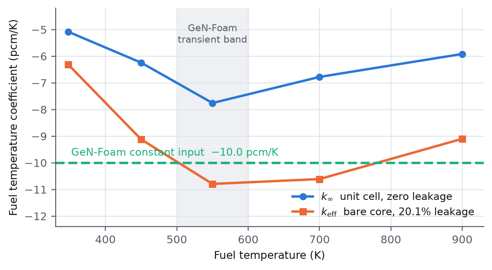
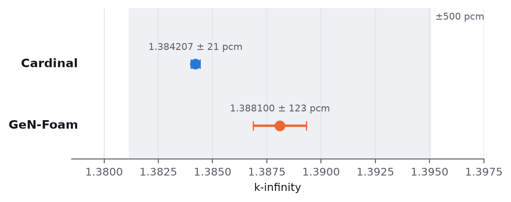

# TRIGA Mark I — Monte Carlo vs Deterministic Cross-Code Study

A code-to-code verification study of a 250 kW TRIGA Mark I research reactor,
solved two ways and compared quantity by quantity:

- **Cardinal**: continuous-energy Monte Carlo neutronics (OpenMC) coupled to
  finite-element heat conduction (MOOSE), with a spectral-element CFD
  model of the coolant (NekRS).
- **GeN-Foam**: two-group diffusion coupled to porous-medium
  thermal-hydraulics in OpenFOAM, with group constants condensed from an
  OpenMC lattice calculation.

Both models were built from one shared problem specification. No GeN-Foam
input, mesh, group constant or output file was read before the Cardinal
results were frozen under the git tag
[`pcm-independent-v1`](https://github.com/kavyawadhwa134/triga-crosscode-verification/tree/pcm-independent-v1).
GeN-Foam's headline values (k∞, k_eff, peaking factor, peak fuel temperature,
transient power) were stated in the task brief; no Cardinal parameter was
adjusted toward them, and the Cardinal core eigenvalue differs from GeN-Foam's
by about 10 000 pcm.

📄 **Full report:** [`docs/TRIGA_MarkI_CrossCode_Report.pdf`](docs/TRIGA_MarkI_CrossCode_Report.pdf)

<p align="center">
  
  <br><em>Coupled OpenMC–MOOSE temperature field in an average TRIGA fuel pin.</em>
</p>

## Why TRIGA

TRIGA fuel is uranium–zirconium hydride. Hydrogen bound in the ZrH lattice
gives a large, prompt, negative fuel temperature coefficient, which is the
basis of the reactor's inherent safety. Reproducing that feedback from
nuclear data, and checking it between two independent methods, is the core
physics requirement of the study.

## Key results

| | Result |
|---|---|
| **Lattice agreement** | k∞ = 1.384207 ± 21 pcm (Cardinal) vs 1.388100 ± 123 pcm (GeN-Foam lattice): **−280 pcm**, inside the 500 pcm criterion |
| **Core eigenvalue explained** | The +10 129 pcm k_eff difference decomposes exactly (terms rounded individually): **+7022 pcm** from core geometry (2-D slab vs 3-D cylinder), +3423 pcm from homogenisation, −331 pcm from diffusion vs Monte Carlo, +16 pcm discretisation |
| **Method difference with geometry matched** | Two-group diffusion vs Monte Carlo in the same homogenised cylinder: **−331 pcm** with a zero-flux vacuum boundary, **+1468 pcm** with an extrapolated (Marshak) boundary. Both lie within the 1275 pcm spread of the Monte Carlo result across hydrogen scattering kernels |
| **TRIGA feedback from first principles** | Fuel temperature coefficient −10.79 ± 0.82 pcm/K (bare core, 500–600 K), from ZrH thermal-scattering data; agrees with the −10.0 pcm/K published value used by GeN-Foam to within 1σ |
| **Leakage feedback quantified** | Leakage contributes 20–36% of the core coefficient, which is 24–57% larger in magnitude than the lattice-only value |
| **Coupled multiphysics verified** | OpenMC–MOOSE peak fuel temperature 359.0 K vs 362.8 K analytic (1.1%); power conserved exactly; cross-platform agreement 7 × 10⁻⁴ K |
| **Solver verified** | GeN-Foam reproduces the analytic two-group solution of its own geometry to 16 pcm |

<p align="center">
  
  <br><em>Additive decomposition of the core eigenvalue difference
  (<a href="results/comparison/keff_decomposition.py">keff_decomposition.py</a>).</em>
</p>

<p align="center">
  
  
  <br><em>Left: fuel temperature coefficient with and without leakage. Right: lattice k∞ comparison.</em>
</p>

## What the study found

1. **Where both codes solve the same problem, they agree.** The Monte Carlo
   pin cell matches to 280 pcm.
2. **The headline core difference is a specification issue, not a code
   error.** The specification gives the core as "0.495 × 0.60 m" without a
   shape. Cardinal read it as a 3-D cylinder and GeN-Foam as a 2-D slab; that
   reading alone is worth about 7000 pcm. With the geometry matched, diffusion
   and Monte Carlo differ by −331 to +1468 pcm depending on the vacuum
   boundary treatment, comparable to the 1275 pcm sensitivity of the
   homogenised model to the hydrogen scattering kernel.
3. **The safety-relevant coefficient is corroborated, with a caveat.** The
   computed coefficient varies from −6.3 to −10.8 pcm/K over 296–1000 K, so
   the constant used in the GeN-Foam transient is only adequate near 500–600 K.

## Scope and limitations

This is **verification, not validation**: no experimental data was used. Both
cores are bare (no reflector or control rods), as the specification
prescribes, so neither describes a physical TRIGA at criticality. Coupled
temperatures are for an average pin with a Dittus–Boelter film coefficient.
The NekRS coolant CFD demonstrated the GPU workflow but is not used for any
result: a post-run check found incomplete heated-wall tagging in the mesh.
Every limitation and the actions to close it are listed in the
[report](docs/TRIGA_MarkI_CrossCode_Report.pdf) (Sections 5–6).

## Repository layout

```
cardinal/            Cardinal model
  openmc/              OpenMC geometry, materials, tallies, runs, temperature sweep
  coupling/            OpenMC <-> MOOSE coupled model (Picard iteration)
  moose/               solid mesh
  nekrs/               coolant subchannel CFD case
genfoam/             GeN-Foam model
  lattice/             OpenMC pin cell and two-group MGXS extraction
  tools/               MGXS -> GeN-Foam nuclearData converter
  triga_steady/        steady-state eigenvalue case
  triga_transient_rod/ +0.5 $ reactivity insertion transient
results/
  cardinal/            Cardinal results (CSV, per-run metadata)
  genfoam/             GeN-Foam results
  comparison/          case-by-case comparison and eigenvalue decomposition
docs/
  TRIGA_MarkI_CrossCode_Report.pdf   full report (LaTeX source in docs/report/)
  specification.md     shared problem definition and assumptions
  cardinal-model.md    Cardinal methods, convergence, verification
  genfoam-model.md     GeN-Foam methods and results
  reproducing.md       environment setup, run commands, regression targets
scripts/             environment detection and run scripts
```

## Reproducing

```bash
./scripts/audit_environment.sh                        # check the toolchain
./scripts/run_openmc.sh unitcell production --seed 11 # k-infinity
./scripts/run_openmc.sh core production --seed 21     # k-effective
./scripts/run_coupled.sh production 8                 # OpenMC <-> MOOSE
python3 results/comparison/keff_decomposition.py      # eigenvalue decomposition
```

Requirements, versions, expected values and known pitfalls are in
[`docs/reproducing.md`](docs/reproducing.md); the GeN-Foam workflow is in
[`docs/genfoam-model.md`](docs/genfoam-model.md).

**Codes and data:** Cardinal (OpenMC 0.15.3-dev, MOOSE, NekRS), GeN-Foam,
OpenMC 0.16.0 for the GeN-Foam lattice, ENDF/B-VIII.0.

## Development notes

AI coding assistants were used for some code scaffolding, debugging and
documentation drafting. The physics modelling, simulation setup, validation
and interpretation of results are the author's own.

## License

Source code is released under the [MIT License](LICENSE). Documentation,
figures, reports and result data are released under
[CC BY 4.0](LICENSE-docs). If you use this work, please cite it
(see [`CITATION.cff`](CITATION.cff)).

## Author

**Kavya Wadhwa** — Pandit Deendayal Energy University
